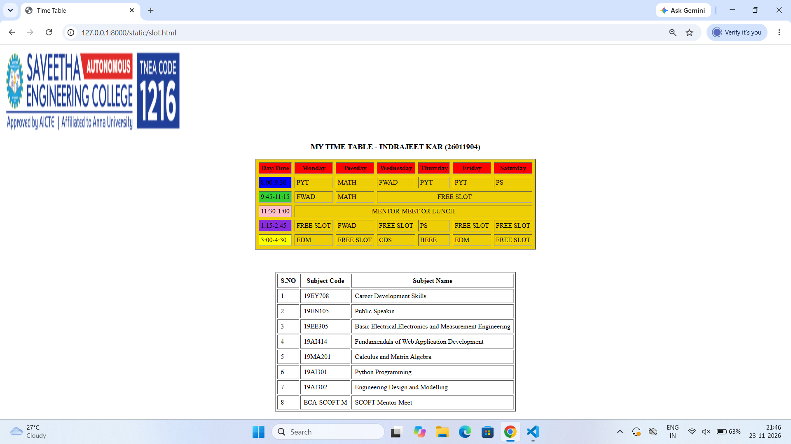

# Ex04 Time Table
## Date:17.11.2026

## AIM
To write a html webpage page to display your slot timetable.

## ALGORITHM
### STEP 1
Create a Django-admin Interface.

### STEP 2
Create an App inside the Django project.

### STEP 2
Create a static folder uder the created App and insert HTML code.

### STEP 3
Create a simple table using ```<table>``` tag in html with the relevant attributes.

### STEP 4
Add rows using ```<tr>``` tag.

### STEP 5
Add your course schedule using ```<td>``` tag.

### STEP 6
Execute the program using runserver command.

## PROGRAM
```<html>
    <head>
        <title>Time Table</title>
    </head>
    <body>
        
        <h3 align="center">MY TIME TABLE - INDRAJEET KAR (26011904)</h3>
        <table border="2" cellspacing="7" cellpadding="4" align="center" style="background-color: rgb(238, 207, 5);">
            <tr style="background-color: red;">
                <th >Day/Time</th>
                <th>Monday</th>
                <th>Tuesday</th>
                <th>Wednesday</th>
                <th>Thursday</th>
                <th>Friday</th>
                <th>Saturday</th>
            </tr>
            <tr>
                <td style="background-color: blue;">8:00-9:30</td>
                <td>PYT</td>
                <td>MATH</td>
                <td>FWAD</td>
                <td>PYT</td>
                <td>PYT</td>
                <td>PS</td>
            </tr>
            <tr>
                <td style="background-color: limegreen;">9:45-11:15</td>
                <td>FWAD</td>
                <td>MATH</td>
                <td colspan="4" align="center">FREE SLOT</td>
            </tr>
            <tr>
                <td style="background-color: pink;">11:30-1:00</td>
                <td colspan="6" align="center"> MENTOR-MEET OR LUNCH</td>
            </tr>
            <tr>
                <td style="background-color: blueviolet;">1:15-2:45</td>
                <td>FREE SLOT</td>
                <td>FWAD</td>
                <td>FREE SLOT</td>
                <td>PS</td>
                <td>FREE SLOT</td>
                <td>FREE SLOT</td>
            </tr>
            <tr>
                <td style="background-color: yellow;">3:00-4:30</td>
                <td>EDM</td>
                <td>FREE SLOT</td>
                <td>CDS</td>
                <td>BEEE</td>
                <td>EDM</td>
                <td>FREE SLOT</td>
            </tr>
        </table><br><br><br>
        <table border="2" cellspacing="3" cellpadding="7" align="center">
            <tr>
                <th>S.NO</th>
                <th>Subject Code</th>
                <th>Subject Name</th>
            </tr>
            <tr>
                <td>1</td>
                <td>19EY708</td>
                <td>Career Development Skills</td>
            </tr>
            <tr>
                <td>2</td>
                <td>19EN105</td>
                <td>Public Speakin</td>
            </tr>
            <tr>
                <td>3</td>
                <td>19EE305</td>
                <td>Basic Electrical,Electronics and Measurement Engineering</td>
            </tr>
            <tr>
                <td>4</td>
                <td>19AI414</td>
                <td>Fundamendals of Web Application Development</td>
            </tr>
            <tr>
                <td>5</td>
                <td>19MA201</td>
                <td>Calculus and Matrix Algebra</td>
            </tr>
            <tr>
                <td>6</td>
                <td>19AI301</td>
                <td>Python Programming</td>
            </tr>
            <tr>
                <td>7</td>
                <td>19AI302</td>
                <td>Engineering Design and Modelling</td>
            </tr>
            <tr>
                <td>8</td>
                <td>ECA-SCOFT-M</td>
                <td>SCOFT-Mentor-Meet</td>
            </tr>
        </table>
    </body>
</html>
```

## OUTPUT


## RESULT
The program for creating slot timetable using basic HTML tags is executed successfully.
